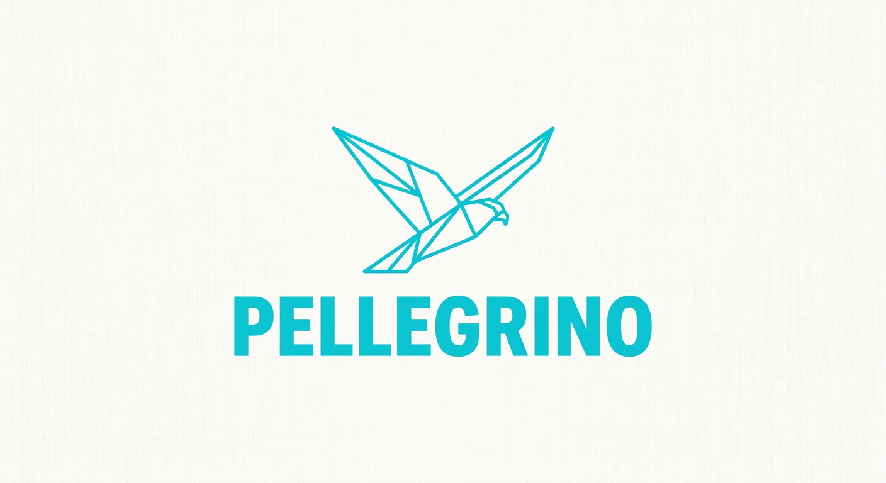

# PELLEGRINO

all gas; no brakes; powered by PARENA
*"Do not confuse momentum with permission."*
With <4 from america

**CLEAN BUILDS FIRST**

A web browser and terminal shell stripped to essentials: no defensive layers, no garbage collection, no
`malloc`. Written in [PARENA](https://github.com/emilyspringerton/PARENA) with a slim C host. Public domain
(The Unlicense). Landing page: [`site/`](site/index.html).

## Status — v1 + HTTPS (honest)

**Works today**
- Borderless SDL2 window (1280x720) that streams a page onto the glass: tags stripped, drifting-cursor
  layout, embedded 5x8 bitmap font, newest bytes tinted amber, a loading-horizon line at the stream front.
- **Live HTTP and HTTPS**: `pellegrino https://host/path` — or press `:` in the window, type a URL, Enter.
  A TCP connection (BSD sockets / winsock2) streams the body onto the glass as bytes land; headers are
  parsed, 301/302/303/307/308 redirects followed (max 5, http<->https included), `<title>/<script>/<style>`
  content skipped.
- **TLS is real and not optional**: `https://` goes through mbedTLS (pinned 3.6 LTS, TLS 1.3 + 1.2),
  and the certificate chain **and hostname are always verified** — there is no switch to turn it off.
  A bad certificate shows a "certificate rejected" page with the reason and renders nothing. mbedTLS
  allocates from one static buffer (2 MiB, BSS), so the no-malloc claim holds for TLS too. Trust roots:
  `SSL_CERT_FILE` if set (unreadable = fail closed, no fallback), else the system bundle, else the
  `cacert.pem` shipped next to the executable (the only store on Windows) — never the current directory.
  A TLS stream that ends without a close_notify (possible truncation) is flagged in the status bar and the
  log instead of being presented as a complete page; navigating away closes the stream being left.
- Source = live URL, embedded page (default), or a file path: `pellegrino path/to/page.html`.
- Keys: `:` address bar, Up/Down/PageUp/PageDown/Home/End or mouse wheel to scroll, Shift+J/L/I/K move the window, Esc/q to quit.
- **No malloc**: the PARENA runtime is built with `-DPARENA_NO_MALLOC` (static pool); the C host is `main()`
  and log redirection only (`pellegrino_host.c`, ~25 lines).
- **Real log files**: `pellegrino.log` (engine), `pellegrino.out.log`, `pellegrino.err.log` next to the
  executable — the Windows build is a windowed (no-console) exe, so nothing lives only in a terminal that
  flashes and closes.
- Bazel build (`bazelisk build //:pellegrino`), headless smoke test under Xvfb (`bazelisk test //...`):
  embedded page, live HTTP, redirect, HTTPS with a trusted / untrusted / wrong-hostname certificate,
  an unreadable bundle, http->https redirect, navigating away mid-stream (no socket/TLS leak), TLS clean
  close vs truncation. The same suite also passes against the cross-compiled `pellegrino.exe` under Wine.
- CI from day 1: every green push to `main` auto-tags a MINOR version and publishes a GitHub Release with
  a Linux bundle (binary + bundled libSDL2 + `cacert.pem` + `RUN.sh`) and a flat Windows zip
  (`pellegrino.exe` + `SDL2.dll` + `cacert.pem` + `RUN.bat`), plus a deterministic CONSTRUCT source snapshot.

- **Hypertext (v1.1):** `<a href>` text is drawn blue + underlined and a left click navigates (absolute,
  root-relative, `//host`, and directory-relative targets). `#fragment` and non-http schemes (`mailto:`,
  `javascript:`) are ignored. **Keyboard:** Tab / Shift+Tab select the next / previous link (wraps; the
  selected link is drawn as an inverse blue bar and scrolled into view), Enter or Space follows it. Not yet:
  `../` dot-segment normalisation (left to the server), link hover/cursor, back/forward history, `<base href>`, `target=`. Hit-testing is cell-based and the
  link colour is not yet verified by eye (no screenshot tool on the build box).

- **CSS, box model, headings, markdown (v1.2; CSS3 and async sheets in v1.9):** see the tables below. Everything is
  re-laid-out from the first byte on every dirty frame, so rules and tags apply the instant their bytes land and the
  page *shifts* as it streams, and again when an external stylesheet arrives (by design: layout shifts are embraced,
  nothing is reserved or anchored). **F12 or `x`** toggles author CSS; **F11 or `p`** toggles markdown rendering
  (the status bar shows `css:on md:on`). With CSS off the UA defaults stay (h1-h6 sizes, link blue, bold/code),
  like a browser with author styles disabled.

  | Area | Supported | Not supported |
  |---|---|---|
  | Sources | `<style>` (honours `media=`), `<link rel=stylesheet href media>` (quoted or unquoted attributes), `@import`, inline `style=""`, `<font color>`, `bgcolor=` | `@font-face`, `@keyframes`, `@container`, `<link>` on file arguments (http(s) pages only), `rel=preload` |
  | Selectors | `tag`, `.class`, `#id`, `*`, compounds (`a.b#c`), descendant and child (`>`), `[attr]` `[a=v]` `^= $= *= ~= \|=`, `:first-child`, `:nth-child(odd/even/N/an+b)`, `:not()`, `:is()`/`:where()`, `:root`, `:link`, `:checked`, `:disabled`, comma lists, **specificity** (ids, classes/attrs/pseudo, tags; ties by source order), `!important` | `+` and `~` combinators, `:last-child`/`:only-child`/`:nth-of-type`/`:empty`, `:hover`/`:focus`/`:active` (such rules never match), `::before`/`::after` (dropped) |
  | At-rules | `@media` (`screen`/`all`, `and`, `not`, `,`, `min/max-width/height`, `(width >= 600px)`, `orientation`; `prefers-color-scheme: dark` is false), `@supports` (assumed true unless `not`), `@layer {}`, `@import url()`/`"..."` (sheet-relative, max 3 deep) | `print` and `speech` (never match) |
  | Colors | `#rgb` `#rgba` `#rrggbb` `#rrggbbaa`, `rgb()`/`rgba()` (comma or space syntax, `%`), `hsl()`/`hsla()`, all CSS Color 3/4 names, `currentcolor`, `transparent`; alpha is blended over the nearest background (or the canvas) at parse time; gradients fall back to their first stop | colour spaces (`lab()`, `color-mix()`), real compositing |
  | Values | `px em rem % pt pc in cm mm ch ex vw vh vmin vmax`, `calc()` (`+ - * /`, parentheses, nested, mixed units; `%` of the parent's width for `width`/`max-width`), `var(--x[, fallback])` (also inside shorthands) with custom properties (document-wide: the `:root` approximation) | `min()`/`max()`/`clamp()`, `var()` in `display`, negative lengths |
  | Properties | `color`, `background[-color\|-image]`, `font`, `font-size` (lengths + keywords -> 4 glyph sizes), `font-weight`, `text-transform`, `display: none/block/inline/inline-block/list-item/flex/inline-flex` (row, equal columns) + `gap`, `flex-direction: column`, `margin[-side]`, `padding[-side]`, `border`, `border-left`, `border-color/-width/-style`, `width`, `max-width`, `box-sizing`, `text-decoration` | `height`/`min-*`, floats, `position`, `grid`, `flex-wrap`/`flex-grow`/`justify-content`/`align-*`, `text-align`, `border-radius`, `box-shadow`, `opacity`, `transform`, `transition`/`animation` (all parsed and ignored), top/right/bottom borders, italic/font-family (one 5x8 bitmap font) |
  | Box model | margin / border / padding on block elements; `width`/`max-width` (a % is of the parent's content width, clamped to it; `box-sizing: border-box` honoured); `margin-left/right: auto` (and `margin: 0 auto`) centre or push a fixed-width block; backgrounds fill the block's rows; **links take an author `color`** (links used to ignore it); vertical margins are whole 18px rows and **adjacent ones collapse** (max, not sum) | `height`, parent/child and empty-block margin collapsing, inline-block, tables as tables |
  | UA defaults (v1.10) | h1-h6 and `p`, `ul`/`ol`/`menu`/`dir`, `pre`, `blockquote`, `dl`, `figure`: 1 row above and below (a list nested in an `li` has none); `ul`/`ol`/`dd`/`figure` indented 36px; an author `margin`/`padding` overrides them, so a `* { margin: 0 }` reset really resets | per-element `em` margins (a row is the unit), `hr` margins, `fieldset`/`table` defaults |
  | Whitespace | In an HTML document (a `<!doctype>`, `<html>` or `<body>` was seen) source newlines, tabs and runs of spaces collapse to one space and vanish at line starts, as in a browser; `<pre>` keeps them. Pages without those tags (plain text, markdown with a stray `<br>`) keep every newline as a line break | `white-space: pre`/`nowrap` |
  | Headings | h1-h6 (glyph scale 4,3,2,2,2,1; h1-h3 bold, distinct colors) | |
  | Markdown | `#`..`######`, `- * +` bullets, `>` quote, fenced code, `---`, `**bold**`, `` `code` ``, `[text](url)` (a real, Tab-selectable link) for `.md`/`.markdown` URLs and file arguments | numbered lists, tables, images, `*italic*`/`_italic_`, nested lists, HTML blocks |

  **Asynchronous stylesheets.** `<link rel=stylesheet>` and `@import` are discovered while the page is scanned and
  queued; the page paints immediately with whatever rules it already has (inline `<style>`, UA defaults), and each
  sheet is fetched through the stream module's second bank without blocking a frame: plain-`http` sheets start while
  the page is still streaming, `https` sheets wait for the page stream to end (the TLS client holds one session), one
  sheet at a time, pulled in bounded batches per frame, 700 idle frames (~6 s) of silence gives up. When a sheet
  lands the whole page restyles from the first byte -- the layout shifts, by design -- and sheets apply in document
  order (a late `<link>` still sits where it was written in the cascade). Logged as `css: fetch|loaded N bytes|failed
  <url>` and `css: rules=N`. Connect and TLS handshake still block (same as ``), a redirect is followed up to 3
  hops, a sheet is capped at 96 KiB (store 256 KiB, 16 sheets, 160 rules, 48 custom properties, style stack depth 11).
  Hostile input (huge, cyclic `@import`, malformed, binary junk, missing, refused) is covered by smoke section 20b.
  Verified by eye in headless (Xvfb) screenshots (before/after a delayed sheet; ~30 selector/value cases) and by
  pixel measurement for `calc()`, `vw`, `border-box` and `rgba()`; the HTTPS sheet path is the same code behind
  `stream-connect-tls` but was **not exercised** here (no mbedTLS dev on the build box).

- **Images (v1.5):** `` of an 8-bit non-interlaced **PNG** (RGB, RGBA, palette; decoded by PARENA's own
  `image/png`) is fetched over http/https once the page stream has closed, decoded, and drawn with nearest-neighbour
  scaling (`width=`/`height=` attributes honoured, shrunk to the box, capped at 320 px high; alpha < 128 is skipped,
  no blending). Until it lands the tag shows `[img] alt`; a failure shows `![img] alt`, and the layout shifts when the
  pixels arrive. Limits: 2048 px a side and 262144 pixels, 2 MiB file, 24 images per page, one fetch per frame and
  each one is synchronous (up to ~3 s of silence while it runs), http(s) pages only (not file arguments), no JPEG/GIF/
  WebP/SVG, no CSS `background-image` images, images are not links-aware (a click on one is just a click). Verified live
  over plain HTTP with RGBA/RGB/palette fixtures and a screenshot; the HTTPS image path is the same code behind
  `stream-connect-tls` but was not exercised on this box (no mbedTLS dev).

- **Forms, entities, keys (v1.6):** `<form>` with text/password/hidden/checkbox/radio/submit `<input>` and `<button>`;
  click to focus, type, Enter or a button submits as **GET** (query string) or **POST**
  (`application/x-www-form-urlencoded` body). Limits: 24 controls, 32-byte values, ~1000 bytes encoded, no `<textarea>`/
  `<select>`/file/validation/multipart, one line per control. HTML entities and curly quotes/dashes decode to ASCII
  look-alikes. **PageUp/PageDown/Home/End** scroll (End = the last screen); **Shift+J/L/I/K** move the window
  (48 px). `<html>`/`<body>` styling (background, color, margin, padding, border, width) works; the canvas takes
  `<html>`'s background, else `<body>`'s. Verified live over plain HTTP under Xvfb; the HTTPS form path is the same
  code but untested here.

- **HTML5 element coverage (v1.7, gaps closed in v1.8):** every HTML5 element is recognised and none leaks its tag or
  leaves the layout unbalanced. Blocks: `p div section article header footer nav main aside address figure
  figcaption fieldset legend hgroup menu search dialog table thead tbody tfoot tr caption dl dt dd ...`;
  `<br>`/`<wbr>`/`<hr>` and all void elements (`area source track param embed col ...`) and `<x/>` self-closers;
  `sub/sup` draw small, `cite/dfn/var` emphasis, `samp/kbd/code` code, `mark` highlighted, `th` bold;
  `u`/`ins` and CSS `text-decoration: underline` draw an underline, `del/s/strike` and `line-through` a strike line
  (plus the dim colour); `<q>` gets quote marks; `template svg math iframe object embed map datalist noembed head`
  are hidden (a hidden element no longer leaves stray blank rows or resets the cursor); `video/audio/canvas/noscript`
  show their fallback text (there is no scripting, so `<noscript>` content is correct to show).
  - `<details>` is collapsed unless `open`; click its `> summary` to toggle (state kept per page, 16 per page).
  - Tables: columns are measured from the source and cells line up (8 columns, 1 text row per cell, unscaled text);
    a row with `<th>` gets a rule under it. No borders, `colspan`/`rowspan`, or wrapping inside cells.
  - `<select>` shows `[ label v ]`, a click steps to the next `<option>`, and the chosen `value` is submitted;
    `<textarea>` is an editable one-line field seeded from its content (newlines dropped, 32 bytes); `<progress>` and
    `<meter>` draw `[####------]`. All of these count toward the 24 controls per page.
  - A `<p>`/heading directly after bare inline text now gets a blank row above it.
  Still not built: multi-line `<textarea>`, a `<select>` popup/`multiple`, `<input type=range|color|date|file>`,
  `<q>` nesting quote styles, `<ruby>`, `<dialog>` modality.

**Not built yet** (see [NORTHSTAR.md](NORTHSTAR.md))
- HTTP/1.0 only (no chunked/keep-alive/compression), HTTP/2, HTTP/3/QUIC (mbedTLS has no QUIC hooks, so
  that rung needs its own TLS answer), other image formats, fonts beyond the embedded bitmap
  font. DNS, connect and the TLS handshake are blocking (5 s connect timeout, 10 s handshake cap), so the
  window does not repaint while one is in flight. No session resumption, no OCSP/CRL revocation checks.
- The Windows exe is verified under Wine (winsock, bcrypt entropy, mbedTLS static heap all exercised), not
  yet on a physical Windows machine.
- The terminal (ANSI/SSH) viewport and the terminal-to-SDL2 hot-swap.
- Any measured performance numbers: the page says "minimal / 0 ms / compact" on purpose — nothing here has
  been benchmarked yet and no figure should be quoted until a harness exists.
- **Safety:** no sandbox, no process isolation. Trusted content only.

## Embedding (v1.11)

The engine can be driven as a library by a host that owns its own window: `embed-open` / `embed-draw` /
`embed-click` / `embed-key` / `embed-action-start`/`-end` (see CHANGELOG 2026-10-15). SHANKPIT's lobby renders its OS
menu this way. Status: `scripts/embed_test.sh` passes (headless, SDL dummy driver); the full browser smoke suite was
not re-run for this change.

## Run

Download the latest release, unzip, and run `RUN.bat` (Windows) or `./RUN.sh` (Linux). Pass a URL as the first argument, or
`--smoke` / `--smoke-url=https://...` / `--smoke-nav="A B"` (load A, then submit B through the address-bar
path) for a self-exiting run (used by the CI smoke test). Check `pellegrino.log` next to the
executable. `SSL_CERT_FILE=/path/to/bundle.pem` overrides the trust roots (e.g. for a private CA).

## Build

```bash
bazelisk build //:pellegrino      # needs libsdl2-dev; fetches + builds the pinned mbedTLS itself
bazelisk test //...               # headless smoke (needs xvfb, openssl, python3)
bash scripts/package_linux.sh     # dist/pellegrino_linux_x86_64.zip
SDL2_MINGW=/path/to/SDL2/x86_64-w64-mingw32 bash scripts/package_windows.sh   # dist/pellegrino_windows.zip
                                  # (mingw-w64; downloads + sha256-verifies the same mbedTLS pin and compiles it)
```

PARENA is pinned by commit in `MODULE.bazel`; to build against a sibling checkout add
`--override_module=parena=../PARENA`.

## Layout

| Path | What |
|---|---|
| `pellegrino.prn` | the engine (PARENA) |
| `pellegrino_host.c` | slim C harness: `main()` + log redirection |
| (PARENA) `stdlib/net/stream.prn` | the cross-platform TCP + TLS streaming primitive this engine stands on |
| `third_party/mbedtls/` | pinned mbedTLS release, its user config (static heap), and the Bazel build rule |
| `tests/smoke.sh`, `tests/smoke_server.py` | headless end-to-end suite (local HTTP + HTTPS fixture servers) |
| `tools/gen_font.py` | generates the embedded 5x8 font table |
| `site/` | landing page |
| `docs/` | founding conversation (raw + transcript), digest |
| `NORTHSTAR.md` | what this is and where it goes |
